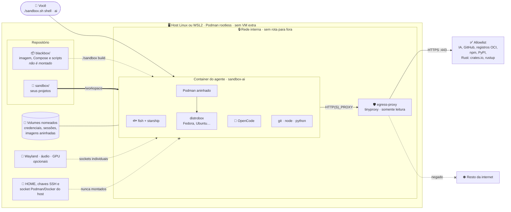

# Blackbox AI Sandbox

Ambiente de desenvolvimento recriável para agentes de IA, com **OpenCode V2, Git, Podman, podman-compose, fish e distrobox**. O agente roda num container rootless, sem o socket do Podman do host, sem `--privileged`, sem outra máquina virtual e sem acesso direto à internet. O padrão é headless; Wayland, PipeWire/PulseAudio, X11 e GPU são ativados somente quando solicitados.

Nenhum caminho deste guia depende do computador onde o repositório foi criado. Todos os comandos são executados na **raiz do repositório** (a pasta que contém este `README.md` e o `sandbox.sh`), qualquer que seja o local do clone.

> **Linux ou WSL2.** Em Linux o ambiente usa apenas containers rootless. No Windows, WSL2 já é uma camada de virtualização do próprio sistema; este projeto não cria uma VM adicional. Em macOS/Windows sem WSL, o Podman Machine normalmente já usa uma VM.

## Visão geral



Um agente de IA trabalha num container rootless que só enxerga a pasta `sandbox/`. Ele não tem rede própria: tudo sai por um proxy que libera apenas uma lista de domínios. Dentro dele há Podman e distrobox para criar outros ambientes sem tocar no host. A validação do contrato de saúde e isolamento é feita por `./sandbox.sh validate`.

## Por que esta abordagem?

- O agente vê somente o diretório escolhido como `/workspace`, não o seu `HOME`.
- O Podman roda **dentro** do sandbox, com imagens e containers aninhados em volume separado.
- Não há `--privileged`, `SYS_ADMIN`, socket Docker/Podman do host, SSH agent ou credenciais herdadas.
- A saída de rede passa por um proxy com allowlist de domínios; sem ele o agente não tem rede.
- Imagem base, OpenCode e starship são fixados por digest/checksum para builds reproduzíveis.
- Credenciais do OpenCode ficam em volumes nomeados, fora do repositório.
- Wayland usa um único socket; PipeWire não é necessário para abrir janelas e só entra para mídia.

Consulte o [modelo de ameaças e limites](blackbox/docs/SECURITY.md): container rootless reduz risco, mas não substitui VM para código hostil de alta severidade.

## Estrutura do repositório

```text
<raiz-do-repositório>/
├── README.md                         este guia (comece por aqui)
├── sandbox.sh                        atalho: repassa os comandos para blackbox/sandbox
├── blackbox/                         AMBIENTE: imagem, Compose, scripts e documentação técnica
│   ├── AGENTS.md                     regras obrigatórias para agentes de IA
│   ├── sandbox                       script real com todos os comandos
│   ├── Containerfile                 imagem rootless, OpenCode e starship verificados
│   ├── compose.yaml                  perfil headless, proxy de egress e volumes
│   ├── compose.*.yaml                GUI, áudio, GPU e portas opcionais
│   ├── .env.example                  modelo das variáveis opcionais
│   ├── scripts/                      entrypoint, healthcheck e testes (copiados para a imagem)
│   ├── scripts/validate.sh           contrato de saúde e isolamento
│   ├── scripts/distrobox-*.sh        adaptação do distrobox ao Podman aninhado
│   ├── config/opencode/              políticas e instruções gerenciadas do OpenCode
│   ├── config/egress/                proxy e allowlist de saída
│   ├── config/sandbox.fish           shell interativo (fish + starship)
│   ├── config/distrobox.conf         padrões do distrobox
│   ├── .opencode/                    agentes revisores e comando /verify
│   └── docs/                         arquitetura, segurança, GUI, OpenCode e fontes
└── sandbox/                          PROJETOS DO USUÁRIO (vira /workspace dentro do container)
    └── README.md                     orientações para seus projetos
```

Regras de separação:

- `sandbox/` é montado como `/workspace` dentro do container. Somente `sandbox/README.md` é versionado; os projetos colocados ali são ignorados por este repositório.
- `blackbox/` **não** é montado no container. Ele só é lido no host durante o `build`. As instruções gerenciadas do OpenCode são copiadas para a imagem, então continuam disponíveis sem misturar os dois diretórios.

## Pré-requisitos do host

- Linux x86_64 ou ARM64 (ou WSL2);
- Podman rootless 5.x/6.x e `podman-compose` 1.x;
- `/dev/fuse`, user namespaces e subordinate UIDs/GIDs configurados;
- Bash, `realpath` e `readlink`.

Instalação dos pacotes, conforme a distribuição:

```bash
# Fedora
sudo dnf install podman podman-compose fuse-overlayfs

# Debian/Ubuntu (a versão do compose varia conforme a release)
sudo apt install podman podman-compose fuse-overlayfs uidmap

# Arch Linux
sudo pacman -S podman podman-compose fuse-overlayfs
```

Verifique sem alterar o host:

```bash
podman info --format '{{.Host.Security.Rootless}}'  # deve imprimir true
grep "^${USER}:" /etc/subuid /etc/subgid
./sandbox.sh doctor
```

Se faltar uma faixa subordinada, siga o [tutorial rootless oficial](https://github.com/containers/podman/blob/main/docs/tutorials/rootless_tutorial.md). Em WSL2, confirme que `/dev/fuse` existe; não desative proteções globais para contornar erros.

## Início rápido

```bash
git clone <URL-DESTE-REPOSITORIO> sandbox
cd sandbox                # raiz do repositório
./sandbox.sh doctor       # confere os pré-requisitos do host
./sandbox.sh build        # constrói a imagem
./sandbox.sh validate     # confere saúde e isolamento
./sandbox.sh ai           # abre o OpenCode
```

No primeiro uso do OpenCode, execute `/connect` na TUI e autentique um provedor. Nenhuma chave de API é copiada do host. O comando `ai` usa `--standalone`, criando um servidor privado para a sessão.

> **Repositório público.** Logo após clonar, ative o hook que bloqueia chaves e tokens em commits:
>
> ```bash
> git config core.hooksPath .githooks
> ```
>
> Enquanto ele não estiver ativo, o `./sandbox.sh` exibe um aviso. Veja [Proteção contra vazamento de chaves](#proteção-contra-vazamento-de-chaves).

### `./sandbox.sh` ou `./sandbox`?

São o mesmo comando, chamados de pastas diferentes:

| Onde você está | Comando |
|---|---|
| Raiz do repositório | `./sandbox.sh <comando>` |
| Pasta `blackbox/` | `./sandbox <comando>` |

Este guia usa a forma da raiz. Os documentos em `blackbox/docs/` usam `./sandbox`.

## Projetos e workspace

Baixe seus projetos dentro de `sandbox/`, nunca em `blackbox/`:

```bash
git -C sandbox clone <URL-DO-PROJETO>
./sandbox.sh ai
```

Para isolar somente um projeto em vez de toda a pasta `sandbox/`, passe um caminho **absoluto** (caminhos relativos são resolvidos a partir de `blackbox/`, não da pasta atual):

```bash
WORKSPACE_DIR="$PWD/sandbox/meu-app" ./sandbox.sh ai
```

O caminho escolhido continua montado como `/workspace`. Arquivos criados nele pertencem ao usuário do host graças ao mapeamento `keep-id:uid=1000,gid=1000`.

## Comandos

| Comando | Função |
|---|---|
| `./sandbox.sh build` | Constrói a imagem fixada. |
| `./sandbox.sh up` | Inicia o perfil headless sem portas. |
| `./sandbox.sh shell` | Abre fish com prompt starship no perfil headless. |
| `./sandbox.sh ai` | Abre OpenCode com servidor privado. |
| `./sandbox.sh run "Explique este repositório"` | Executa um prompt não interativo. |
| `./sandbox.sh exec <cmd>` | Executa um comando no perfil atual. |
| `./sandbox.sh verify` | Testa ferramentas, escrita, contenção de rede e Podman aninhado (de dentro do container). |
| `./sandbox.sh validate` | Valida saúde e isolamento de fora e de dentro dos containers; `--static` só confere os arquivos. |
| `./sandbox.sh gui` | Abre shell com Wayland e áudio detectado. |
| `./sandbox.sh gui-verify` | Testa containers, Wayland e áudio. |
| `./sandbox.sh ports` | Perfil headless com `APP_PORT` publicada em loopback. |
| `./sandbox.sh doctor` | Mostra pré-requisitos e sockets do host. |
| `./sandbox.sh status` / `logs` | Inspeciona o serviço. |
| `./sandbox.sh down` | Remove o container e preserva os volumes; não aceita opções. |
| `./sandbox.sh reset` | **Apaga todos os volumes**, após confirmação. |

Todas as opções estão em `./sandbox.sh help`.

Trocar de perfil com `up`, `ports` ou `gui` recria o container para aplicar/remover mounts, com um aviso quando ele está em execução. `shell`, `ai`, `run`, `verify`, `validate` e `exec` reutilizam um container GUI ou com portas já em execução, desde que use a imagem e o workspace atuais; só sem ele sobem o perfil headless. Mudanças de workspace, imagem, overrides e das opções usadas pelo perfil (sockets e `DISPLAY` na GUI, GPU, `APP_PORT` em `ports`) são detectadas por um identificador de configuração; variáveis que o perfil não usa não causam recriação. Os volumes persistem, mas processos em execução no container antigo são encerrados.

## Configuração opcional (`blackbox/.env`)

O arquivo `blackbox/.env` **não é obrigatório**. Sem ele, o script usa estes padrões:

| Variável | Padrão | Para que serve |
|---|---|---|
| `SANDBOX_NAME` | `sandbox-ai` | nome do container (o proxy vira `<nome>-egress`) |
| `WORKSPACE_DIR` | `../sandbox` | pasta montada como `/workspace` |
| `SANDBOX_PIDS_LIMIT` | `2048` | limite de processos do container |
| `APP_PORT` | `8080` | porta publicada no perfil `ports` |
| `DRI_DEVICE` | `/dev/dri/renderD128` | GPU no perfil `gui --gpu` |

Crie o arquivo só para mudar algum desses valores de forma fixa:

```bash
cp blackbox/.env.example blackbox/.env
```

- Só essas cinco variáveis são lidas; outras linhas são ignoradas e o arquivo nunca é executado como script.
- Uma variável definida no comando tem prioridade sobre o `.env` (por exemplo, `WORKSPACE_DIR=... ./sandbox.sh ai`).
- O `.env` está no `.gitignore`. Mesmo assim, não coloque chaves de API nele: credenciais são configuradas com `/connect` no OpenCode e ficam num volume do Podman.

## Shell e distrobox

`./sandbox.sh shell` (e `gui` sem comando) abre **fish** com prompt **starship**, independente do shell do host: o shell de login do usuário no container é `/usr/bin/fish`. O prompt usa o preset `no-nerd-font` em `/etc/starship.toml`, que funciona em qualquer terminal sem fontes especiais; um `~/.config/starship.toml` pessoal tem prioridade. Bash continua instalado e é usado pelos scripts.

O **distrobox** cria ambientes de outras distribuições sobre o Podman aninhado, com `/workspace` e o `HOME` do sandbox montados:

```bash
./sandbox.sh shell
distrobox create -n ubuntu -i docker.io/library/ubuntu:24.04
distrobox enter ubuntu
sudo apt update && sudo apt install -y build-essential
```

Os distroboxes ficam no volume `podman-storage` e sobrevivem à recriação do sandbox. Eles herdam a rede do sandbox, portanto também só saem pelo proxy: o `sudo` preserva as variáveis de proxy, mas repositórios de pacotes fora da allowlist precisam ser [liberados](#liberar-domínios-na-allowlist). O "host" do distrobox (`/run/host`, `distrobox-host-exec`) é o container do sandbox, não a sua máquina.

## Aplicativos gráficos

Em uma sessão local com Wayland:

```bash
./sandbox.sh gui
# Dentro do sandbox:
foot
```

O script também detecta XWayland e áudio. Para testar tudo:

```bash
./sandbox.sh gui-verify
./sandbox.sh exec foot      # teste visual nativo Wayland
./sandbox.sh exec xeyes     # teste visual de compatibilidade X11
```

Opções:

```bash
./sandbox.sh gui --no-audio       # somente vídeo
./sandbox.sh gui --no-x11         # somente Wayland
./sandbox.sh gui --gpu            # /dev/dri/renderD128, opt-in
./sandbox.sh gui --wslg-gpu       # vGPU do WSLg, opt-in
./sandbox.sh gui -- foot          # inicia o aplicativo diretamente
```

**PipeWire não é necessário para vídeo.** Ele é necessário apenas quando o aplicativo usa a API nativa de áudio/vídeo. Aplicações PulseAudio também são suportadas, inclusive o socket do WSLg. Microfone e outras fontes podem ficar acessíveis ao aplicativo quando o socket de mídia é compartilhado.

Mais detalhes e solução de problemas em [blackbox/docs/GUI.md](blackbox/docs/GUI.md).

## Podman e Compose dentro do sandbox

O socket `podman.sock` do host **não** é montado. Estes comandos usam o armazenamento aninhado:

```bash
./sandbox.sh shell
podman run --rm docker.io/library/busybox:1.37.0@sha256:a7dbc319b1438115a207e11930dc4bb3e643dcb3ec0bdd694bb36cd8fad289ec echo ok
podman ps -a
podman-compose --version
```

O `verify` executa um BusyBox sem rede, somente leitura e sem capabilities. Use `VERIFY_PULL=0 ./sandbox.sh verify` para não baixar essa imagem de teste.

Os containers internos usam a rede do container externo, conforme a configuração recomendada da imagem oficial `quay.io/podman/stable`. Assim, publicar uma porta no Podman **interno** não a publica automaticamente no host. Para expor `APP_PORT` somente em loopback:

```bash
APP_PORT=8080 ./sandbox.sh ports
# Aplicação escutando em 0.0.0.0:8080 dentro do sandbox fica em:
# http://127.0.0.1:8080
```

## Rede de saída e allowlist

O container do agente fica somente na rede interna `sandbox_internal`, sem rota padrão nem DNS externo. A única saída é o serviço `egress-proxy` (tinyproxy, container `sandbox-ai-egress`), que também está na rede `sandbox_egress` e encaminha apenas para os domínios de [`blackbox/config/egress/allowlist.txt`](blackbox/config/egress/allowlist.txt), e HTTPS somente na porta 443. `HTTP(S)_PROXY` já vem configurado, então `curl`, `git`, `npm`, `pip`, `cargo`, OpenCode e pulls do Podman aninhado funcionam sem ajuste; programas que ignoram o proxy simplesmente não têm rede. O `verify` confirma que não há rota direta, que um host fora da lista é negado e que um host liberado responde.

### Liberar domínios na allowlist

A lista fica dentro da imagem, então editar o arquivo só tem efeito depois de um novo build.

**1. Descubra qual domínio foi negado:**

```bash
podman logs sandbox-ai-egress 2>&1 | grep 'filtered domain'
# NOTICE ... Proxying refused on filtered domain "registry.terraform.io"
```

**2. Acrescente uma linha** em `blackbox/config/egress/allowlist.txt`, no formato `(^|\.)dominio\.tld$`, de preferência num grupo com comentário:

```text
# Terraform
(^|\.)terraform\.io$
```

- `(^|\.)` libera o domínio e todos os subdomínios (`registry.terraform.io`, `releases.terraform.io`), mas não `outroterraform.io`.
- Escape os pontos com `\.`.
- O `$` no fim é obrigatório. Sem ele, `terraform.io.site-malicioso.com` também passaria.

**3. Reconstrua e aplique:**

```bash
./sandbox.sh build
./sandbox.sh up          # recria o proxy com a nova política
./sandbox.sh validate
```

**4. Teste de dentro do sandbox:**

```bash
./sandbox.sh exec curl -sS -o /dev/null -w '%{http_code}\n' https://registry.terraform.io
```

Qualquer código HTTP, mesmo 403 ou 404, quer dizer que o proxy deixou passar. Se o domínio continuar bloqueado, o `curl` falha com `CONNECT tunnel failed`.

Cuidados:

- O `validate` aceita apenas linhas nesse formato (checagem S-06). Uma regra genérica como `.*`, ou uma sem o `$` no fim, é recusada de propósito.
- O proxy só abre HTTPS na porta 443. Um serviço em outra porta, como SSH na 22 para `git@github.com`, não passa adicionando o domínio; para o Git, use a URL `https://`.
- Libere só o necessário. Todo domínio da lista também é um lugar para onde código comprometido poderia enviar dados.
- Gerenciadores de pacotes às vezes baixam de mirrors com outros nomes. Se o `dnf` ou o `apt` de um distrobox falhar, repita o passo 1 para descobrir quais hosts liberar.

## Persistência e recriação

| Volume | Conteúdo |
|---|---|
| `opencode-config` | Configuração global do usuário no sandbox. |
| `opencode-data` | Sessões, banco de dados e credenciais do OpenCode. |
| `opencode-cache` | Cache descartável do OpenCode. |
| `podman-storage` | Imagens, volumes e containers do Podman aninhado, incluindo distroboxes. |

O resto do `HOME` do container (por exemplo, um toolchain instalado com rustup em `~/.cargo`) fica na camada descartável e some quando o container é recriado. Excluir os volumes com `reset` não apaga o workspace, mas remove permanentemente esses dados e todos os containers aninhados.

### Replicar em outra máquina

1. Instale os pré-requisitos do host.
2. Clone este repositório em qualquer pasta.
3. Na raiz do clone, execute `./sandbox.sh build` e `./sandbox.sh validate`.
4. Baixe seus projetos somente dentro de `sandbox/`.

As imagens são recriadas pelo `blackbox/Containerfile`. Os volumes **não acompanham o clone**; faça backup separado se precisar de sessões, credenciais ou imagens.

A imagem base é fixada por digest e o OpenCode e o starship por versão/SHA-256. Pacotes RPM auxiliares vêm dos repositórios Fedora no momento do build, portanto o resultado é reproduzível no nível de configuração, não uma promessa de build bit a bit idêntico ao longo de anos.

## Servidor headless e GUI remota

No servidor, use `up`, `shell`, `ai` e `validate` normalmente via SSH. Não há socket gráfico para detectar.

Um socket Wayland é local ao servidor: montá-lo não o transporta para o seu laptop. Para exibir remotamente um aplicativo Wayland, use uma camada como [`waypipe` sobre SSH](https://docs.redhat.com/en/documentation/red_hat_enterprise_linux/9/html/getting_started_with_the_gnome_desktop_environment/remotely-accessing-an-individual-application-wayland_getting-started-with-the-gnome-desktop-environment), instalada nos dois lados, ou outra solução de desktop remoto. Não exponha o compositor por TCP e não ative X11 forwarding sem avaliar o modelo de confiança.

## Proteção contra vazamento de chaves

Este repositório é público: tudo que entra num commit enviado ao GitHub deve ser tratado como publicado para sempre. Há três barreiras:

| Barreira | Onde | O que faz |
|---|---|---|
| `.gitignore` | raiz | Ignora `.env`, chaves (`*.pem`, `*.key`, `id_*`), `credentials.json`, `.npmrc`, `.netrc`, `*.tfvars` etc. |
| Hook `pre-commit` | `.githooks/pre-commit` | Bloqueia o commit se o stage tiver arquivo sensível ou texto com formato de chave (AWS, GitHub, GitLab, Anthropic/OpenAI, Google, Slack, Stripe, npm, JWT, chave privada, senha em URL, `password = "..."`). Usa o [gitleaks](https://github.com/gitleaks/gitleaks) quando instalado e sempre executa a verificação embutida. O segredo nunca é impresso. |
| CI `secret-scan` | `.github/workflows/secret-scan.yml` | Em todo push e pull request, roda o gitleaks (versão e SHA-256 fixos) sobre **todo o histórico** e repete as regras do hook. Pega o que escapou do hook local. |

Regras:

- Ative o hook em cada clone: `git config core.hooksPath .githooks`.
- Não use `git commit --no-verify` para contornar o bloqueio.
- Falso positivo: adicione o comentário `gitleaks:allow` na linha e explique o motivo na mensagem do commit.
- Valores padrão não secretos ficam em `blackbox/.env.example`; valores reais ficam em `blackbox/.env`, que é ignorado.
- **Se uma chave chegou a um commit**, revogue-a no provedor imediatamente. Apagar o arquivo ou reescrever o histórico não basta: o GitHub e clones podem manter cópias.

Recomendado no GitHub (*Settings → Code security*): ativar **Secret scanning** e **Push protection**, gratuitos para repositórios públicos.

## Guia para agentes de IA

Se você é um agente lendo este repositório, siga esta ordem:

1. **Leia `blackbox/AGENTS.md` antes de qualquer alteração.** Ele contém os limites de segurança e as convenções obrigatórias.
2. Para entender o funcionamento, leia este `README.md` e depois `blackbox/docs/ARCHITECTURE.md`.
3. Antes de mexer em privilégios, mounts ou rede, leia `blackbox/docs/SECURITY.md`.
4. Rode `./sandbox.sh validate` antes e depois de mudanças no ambiente.
5. Consulte o arquivo certo para cada assunto:

| Assunto | Arquivo |
|---|---|
| Lista de comandos e variáveis | `blackbox/sandbox` (função `usage`) ou `./sandbox.sh help` |
| Imagem e pacotes instalados | `blackbox/Containerfile` |
| Container, mounts, rede e volumes | `blackbox/compose.yaml` |
| GUI, áudio, GPU e portas | `blackbox/compose.<perfil>.yaml` e `blackbox/docs/GUI.md` |
| Allowlist de rede | `blackbox/config/egress/allowlist.txt` |
| Testes do ambiente | `blackbox/scripts/verify.sh` (dentro do container) |
| Contrato de saúde e isolamento | `blackbox/scripts/validate.sh` (`./sandbox.sh validate`) |
| Permissões do OpenCode | `blackbox/config/opencode/opencode.jsonc` e `blackbox/docs/OPENCODE.md` |
| Agentes revisores | `blackbox/.opencode/agents/` |
| Valores padrão opcionais | `blackbox/.env.example` (copie para `blackbox/.env`) |

Fatos importantes:

- Caminhos nos documentos são relativos à raiz do repositório ou a `blackbox/`, conforme indicado. Não presuma um caminho absoluto específico.
- Dentro do container, só existe `/workspace` (conteúdo de `sandbox/`). `blackbox/` não está acessível; as instruções do agente estão em `/etc/opencode`.
- Mudanças em `blackbox/` só valem dentro do container após `./sandbox.sh build`.
- Commits seguem [Conventional Commits](https://www.conventionalcommits.org/pt-br/v1.0.0/) (ex.: `docs(cli): explicar WORKSPACE_DIR absoluto`). Tipos, escopos e regras estão em `blackbox/AGENTS.md`, seção "Mensagens de commit".

## Documentação

- [Instruções para agentes](blackbox/AGENTS.md)
- [Arquitetura e decisões](blackbox/docs/ARCHITECTURE.md)
- [Segurança e limites](blackbox/docs/SECURITY.md)
- [Wayland, PipeWire, WSLg e servidores](blackbox/docs/GUI.md)
- [Uso e instruções do OpenCode](blackbox/docs/OPENCODE.md)
- [Fontes pesquisadas](blackbox/docs/SOURCES.md)
- [Orientações do espaço de trabalho](sandbox/README.md)
