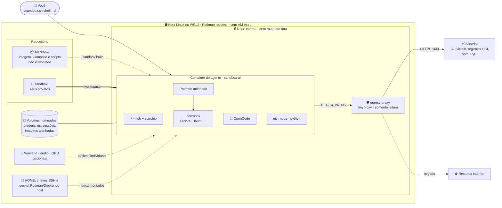

# Blackbox AI Sandbox

Repositório completo para recriar um ambiente de desenvolvimento com **OpenCode V2, Git, Podman e podman-compose**, sem montar o socket do Podman do host e sem `--privileged`.

Nenhum caminho deste guia depende do computador onde o repositório foi criado. Todos os comandos são relativos à **raiz do repositório** (a pasta que contém este `README.md` e o `sandbox.sh`), qualquer que seja o local do clone.

## Visão geral



Um agente de IA trabalha num container rootless que só enxerga a pasta `sandbox/`. Ele não tem rede própria: tudo sai por um proxy que libera apenas uma lista de domínios. Dentro dele há Podman e distrobox para criar outros ambientes sem tocar no host. Detalhes no [guia técnico](blackbox/README.md).

## Estrutura do repositório

```text
<raiz-do-repositório>/
├── README.md             # este guia (comece por aqui)
├── sandbox.sh            # atalho: repassa os comandos para blackbox/sandbox
├── blackbox/             # AMBIENTE: imagem, Compose, scripts e documentação técnica
│   ├── README.md         # guia técnico completo
│   ├── AGENTS.md         # regras obrigatórias para agentes de IA
│   ├── sandbox           # script real com todos os comandos
│   ├── Containerfile     # definição da imagem
│   ├── compose*.yaml     # perfil padrão e perfis opcionais (GUI, áudio, GPU, portas)
│   ├── scripts/          # entrypoint, healthcheck, testes e validate.sh (contrato)
│   ├── config/           # OpenCode, proxy de egress, Git, fish e distrobox (copiados para a imagem)
│   ├── .opencode/        # agentes e comandos do OpenCode (copiados para a imagem)
│   └── docs/             # arquitetura, segurança, GUI, OpenCode e fontes
└── sandbox/              # PROJETOS DO USUÁRIO (vira /workspace dentro do container)
    └── README.md
```

Regras de separação:

- `sandbox/` é montado como `/workspace` dentro do container. Somente `sandbox/README.md` é versionado; os projetos colocados ali são ignorados por este repositório.
- `blackbox/` **não** é montado no container. Ele só é lido no host durante o `build`.

## Pré-requisitos

- Linux ou WSL2;
- Podman rootless e `podman-compose`;
- `/dev/fuse`, user namespaces e subordinate UIDs/GIDs;
- Bash.

Comandos de instalação por distribuição estão em [blackbox/README.md](blackbox/README.md#pré-requisitos-do-host).

## Início rápido

```bash
git clone <URL-DESTE-REPOSITORIO> sandbox
cd sandbox                # raiz do repositório
./sandbox.sh doctor       # confere os pré-requisitos do host
./sandbox.sh build        # constrói a imagem
./sandbox.sh verify       # testa ferramentas e Podman aninhado
./sandbox.sh ai           # abre o OpenCode
```

No primeiro uso do OpenCode, execute `/connect` para autenticar um provedor. Nenhuma credencial do host é copiada automaticamente.

> **Repositório público.** Logo após clonar, ative o hook que bloqueia chaves e tokens em commits:
>
> ```bash
> git config core.hooksPath .githooks
> ```
>
> Enquanto ele não estiver ativo, o `./sandbox.sh` exibe um aviso. Veja [Proteção contra vazamento de chaves](#proteção-contra-vazamento-de-chaves).

### `./sandbox.sh` ou `./sandbox`?

São o mesmo comando, chamados de pastas diferentes:

| Onde você está | Comando |
|---|---|
| Raiz do repositório | `./sandbox.sh <comando>` |
| Pasta `blackbox/` | `./sandbox <comando>` |

A documentação dentro de `blackbox/` usa a forma `./sandbox`; na raiz, troque por `./sandbox.sh`.

## Baixar projetos

Execute a partir da raiz do repositório:

```bash
git -C sandbox clone <URL-DO-PROJETO>
./sandbox.sh ai
```

Para expor somente um projeto, passe um caminho **absoluto** (caminhos relativos são resolvidos a partir de `blackbox/`, não da pasta atual):

```bash
WORKSPACE_DIR="$PWD/sandbox/meu-app" ./sandbox.sh ai
```

## Comandos frequentes

| Comando | Função |
|---|---|
| `./sandbox.sh build` | Constrói a imagem. |
| `./sandbox.sh verify` | Testa ferramentas e Podman aninhado. |
| `./sandbox.sh gui-verify` | Testa containers, Wayland e áudio. |
| `./sandbox.sh validate` | Valida saúde e isolamento (contrato do ambiente). |
| `./sandbox.sh shell` | Abre fish + starship no perfil headless. |
| `./sandbox.sh gui` | Abre shell com Wayland e áudio detectado. |
| `./sandbox.sh status` | Mostra o estado do serviço. |
| `./sandbox.sh down` | Remove o container e preserva os volumes. |

Todas as demais opções estão em `./sandbox.sh help`.

## Replicar em outra máquina

1. Instale os pré-requisitos do host.
2. Clone este repositório em qualquer pasta.
3. Na raiz do clone, execute `./sandbox.sh build` e `./sandbox.sh verify`.
4. Baixe seus projetos somente dentro de `sandbox/`.

As imagens são recriadas pelo `blackbox/Containerfile`. Credenciais, sessões do OpenCode e armazenamento aninhado ficam em volumes do Podman e **não acompanham o clone**; faça backup separado se precisar migrá-los.

## Proteção contra vazamento de chaves

Este repositório é público: tudo que entra num commit enviado ao GitHub deve ser tratado como publicado para sempre. Há três barreiras:

| Barreira | Onde | O que faz |
|---|---|---|
| `.gitignore` | raiz | Ignora `.env`, chaves (`*.pem`, `*.key`, `id_*`), `credentials.json`, `.npmrc`, `.netrc`, `*.tfvars` etc. |
| Hook `pre-commit` | `.githooks/pre-commit` | Bloqueia o commit se o stage tiver arquivo sensível ou texto com formato de chave (AWS, GitHub, GitLab, Anthropic/OpenAI, Google, Slack, Stripe, npm, JWT, chave privada, senha em URL, `password = "..."`). Usa o [gitleaks](https://github.com/gitleaks/gitleaks) quando instalado e sempre executa a verificação embutida. O segredo nunca é impresso. |
| CI `secret-scan` | `.github/workflows/secret-scan.yml` | Em todo push e pull request, roda o gitleaks (versão e SHA-256 fixos) sobre **todo o histórico** e repete as regras do hook. Pega o que escapou do hook local. |

Regras:

- Ative o hook em cada clone: `git config core.hooksPath .githooks`.
- Não use `git commit --no-verify` para contornar o bloqueio.
- Falso positivo: adicione o comentário `gitleaks:allow` na linha e explique o motivo na mensagem do commit.
- Valores padrão não secretos ficam em `blackbox/.env.example`; valores reais ficam em `blackbox/.env`, que é ignorado.
- **Se uma chave chegou a um commit**, revogue-a no provedor imediatamente. Apagar o arquivo ou reescrever o histórico não basta: o GitHub e clones podem manter cópias.

Recomendado no GitHub (*Settings → Code security*): ativar **Secret scanning** e **Push protection**, gratuitos para repositórios públicos.

## Guia para agentes de IA

Se você é um agente lendo este repositório, siga esta ordem:

1. **Leia `blackbox/AGENTS.md` antes de qualquer alteração.** Ele contém os limites de segurança e as convenções obrigatórias.
2. Para entender o funcionamento, leia `blackbox/README.md` e depois `blackbox/docs/ARCHITECTURE.md`.
3. Antes de mexer em privilégios, mounts ou rede, leia `blackbox/docs/SECURITY.md`.
4. Consulte o arquivo certo para cada assunto:

| Assunto | Arquivo |
|---|---|
| Lista de comandos e variáveis | `blackbox/sandbox` (função `usage`) ou `./sandbox.sh help` |
| Imagem e pacotes instalados | `blackbox/Containerfile` |
| Container, mounts e volumes | `blackbox/compose.yaml` |
| GUI, áudio, GPU e portas | `blackbox/compose.<perfil>.yaml` e `blackbox/docs/GUI.md` |
| Testes do ambiente | `blackbox/scripts/verify.sh` (dentro do container) |
| Contrato de saúde e isolamento | `blackbox/scripts/validate.sh` (`./sandbox.sh validate`) |
| Permissões do OpenCode | `blackbox/config/opencode/opencode.jsonc` e `blackbox/docs/OPENCODE.md` |
| Agentes revisores | `blackbox/.opencode/agents/` |
| Valores padrão opcionais | `blackbox/.env.example` (copie para `blackbox/.env`) |

Fatos importantes:

- Caminhos nos documentos são relativos à raiz do repositório ou a `blackbox/`, conforme indicado. Não presuma um caminho absoluto específico.
- Dentro do container, só existe `/workspace` (conteúdo de `sandbox/`). `blackbox/` não está acessível; as instruções do agente estão em `/etc/opencode`.
- Mudanças em `blackbox/` só valem dentro do container após `./sandbox.sh build`.
- Commits seguem [Conventional Commits](https://www.conventionalcommits.org/pt-br/v1.0.0/) (ex.: `docs(cli): explicar WORKSPACE_DIR absoluto`). Tipos, escopos e regras estão em `blackbox/AGENTS.md`, seção "Mensagens de commit".

## Documentação

- [Guia técnico do Blackbox](blackbox/README.md)
- [Instruções para agentes](blackbox/AGENTS.md)
- [Arquitetura](blackbox/docs/ARCHITECTURE.md)
- [Segurança e limites](blackbox/docs/SECURITY.md)
- [Wayland, PipeWire e WSLg](blackbox/docs/GUI.md)
- [OpenCode e agentes](blackbox/docs/OPENCODE.md)
- [Fontes pesquisadas](blackbox/docs/SOURCES.md)
- [Orientações do espaço de trabalho](sandbox/README.md)
