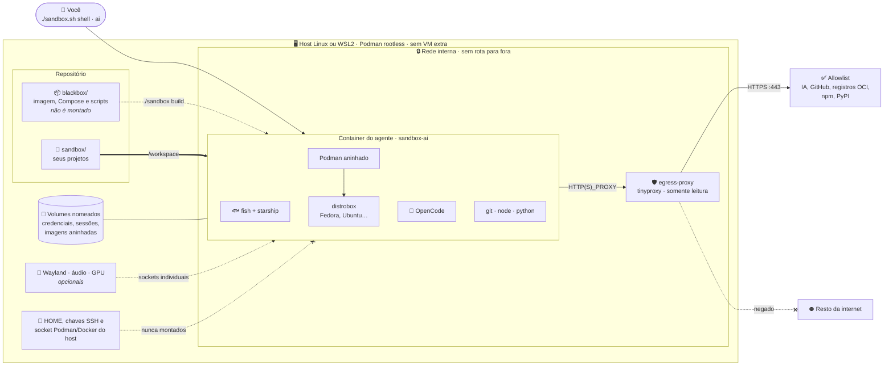

# Sandbox AI com Podman e OpenCode

Ambiente de desenvolvimento recriável com **OpenCode V2, Git, Podman e podman-compose**, sem montar o socket do Podman do host e sem criar outra máquina virtual. O padrão é headless; Wayland, PipeWire/PulseAudio, X11 e GPU são ativados somente quando solicitados.

> **Linux ou WSL2.** Em Linux o ambiente usa apenas containers rootless. No Windows, WSL2 já é uma camada de virtualização do próprio sistema; este projeto não cria uma VM adicional. Em macOS/Windows sem WSL, o Podman Machine normalmente já usa uma VM.

## Visão geral



O agente trabalha num container rootless que só enxerga a pasta de projetos. Ele não tem rede própria: tudo sai por um proxy que libera apenas uma lista de domínios. Dentro dele há Podman e distrobox para criar outros ambientes sem tocar no host. A validação do contrato de saúde e isolamento é feita por `./sandbox validate`.

## Separação entre ambiente e projetos

```text
<raiz-do-repositório>/
├── sandbox.sh    # atalho para blackbox/sandbox
├── blackbox/     # esta pasta: imagem, Compose, scripts e documentação
└── sandbox/      # seus projetos e demais arquivos de trabalho
```

Somente `sandbox/` é montado por padrão como `/workspace` **dentro do container**. O `blackbox` não é montado. As instruções gerenciadas do OpenCode ficam na imagem, portanto continuam disponíveis sem misturar os dois diretórios.

## Por que esta abordagem?

- O agente vê somente o diretório escolhido como `/workspace`, não o seu `HOME`.
- O Podman roda **dentro** do sandbox, com imagens e containers aninhados em volume separado.
- Não há `--privileged`, `SYS_ADMIN`, socket Docker/Podman do host, SSH agent ou credenciais herdadas.
- OpenCode, checksums e imagem base são fixados para builds reproduzíveis.
- Credenciais do OpenCode ficam em volumes nomeados, fora do repositório.
- A saída de rede passa por um proxy com allowlist de domínios; sem ele o agente não tem rede.
- Wayland usa um único socket; PipeWire não é necessário para abrir janelas e só entra para mídia.

Consulte o [modelo de ameaças e limites](docs/SECURITY.md): container rootless reduz risco, mas não substitui VM para código hostil de alta severidade.

## Pré-requisitos do host

- Linux x86_64 ou ARM64 (ou WSL2);
- Podman rootless 5.x/6.x e `podman-compose` 1.x;
- `/dev/fuse`, user namespaces e subordinate UIDs/GIDs configurados;
- Bash, `realpath` e `readlink`.

Instalação dos pacotes, conforme a distribuição:

```bash
# Fedora
sudo dnf install podman podman-compose fuse-overlayfs

# Debian/Ubuntu (a versão do compose varia conforme a release)
sudo apt install podman podman-compose fuse-overlayfs uidmap

# Arch Linux
sudo pacman -S podman podman-compose fuse-overlayfs
```

Verifique sem alterar o host:

```bash
podman info --format '{{.Host.Security.Rootless}}'  # deve imprimir true
grep "^${USER}:" /etc/subuid /etc/subgid
./sandbox doctor
```

Se faltar uma faixa subordinada, siga o [tutorial rootless oficial](https://github.com/containers/podman/blob/main/docs/tutorials/rootless_tutorial.md). Em WSL2, confirme que `/dev/fuse` existe; não desative proteções globais para contornar erros.

## Início rápido

```bash
git clone <URL-DESTE-REPOSITORIO> sandbox
cd sandbox
./sandbox.sh build
./sandbox.sh verify
./sandbox.sh ai
```

Na raiz, `sandbox.sh` é um roteador para `blackbox/sandbox`. **Daqui em diante, os comandos deste guia são executados dentro de `blackbox/`, usando `./sandbox`.** Na raiz do repositório, use `./sandbox.sh` com os mesmos argumentos.

No primeiro uso do OpenCode, execute `/connect` na TUI e autentique um provedor. Nenhuma chave de API é copiada do host. O comando `ai` usa `--standalone`, criando um servidor privado para a sessão.

Para abrir somente um shell:

```bash
./sandbox shell
```

Baixe seus projetos no diretório de trabalho, fora do `blackbox`:

```bash
git -C ../sandbox clone <URL-DO-PROJETO>
```

Para isolar somente um projeto em vez de toda a pasta `sandbox`, informe um caminho absoluto (caminhos relativos são resolvidos a partir de `blackbox/`):

```bash
WORKSPACE_DIR="$(realpath ../sandbox/meu-app)" ./sandbox ai
```

O caminho escolhido continua montado como `/workspace`. Arquivos criados nele pertencem ao usuário do host graças ao mapeamento `keep-id:uid=1000,gid=1000`.

## Comandos

| Comando | Função |
|---|---|
| `./sandbox build` | Constrói a imagem fixada. |
| `./sandbox up` | Inicia o perfil headless sem portas. |
| `./sandbox shell` | Abre fish com prompt starship no perfil headless. |
| `./sandbox ai` | Abre OpenCode com servidor privado. |
| `./sandbox run "Explique este repositório"` | Executa um prompt não interativo. |
| `./sandbox exec <cmd>` | Executa um comando no perfil atual. |
| `./sandbox verify` | Testa ferramentas, escrita, contenção de rede e Podman aninhado. |
| `./sandbox validate` | Valida saúde e isolamento de fora e de dentro dos containers; `--static` só confere os arquivos. |
| `./sandbox gui` | Abre shell com Wayland e áudio detectado. |
| `./sandbox gui-verify` | Testa containers, Wayland e áudio. |
| `./sandbox doctor` | Mostra pré-requisitos e sockets do host. |
| `./sandbox status` / `logs` | Inspeciona o serviço. |
| `./sandbox down` | Remove o container e preserva os volumes; não aceita opções. |
| `./sandbox reset` | **Apaga todos os volumes**, após confirmação. |

Trocar de perfil com `up`, `ports` ou `gui` recria o container para aplicar/remover mounts, com um aviso quando ele está em execução. `shell`, `ai`, `run`, `verify` e `exec` reutilizam um container GUI ou com portas já em execução, desde que use a imagem e o workspace atuais; só sem ele sobem o perfil headless. Mudanças de workspace, imagem, overrides e das opções usadas pelo perfil (sockets e `DISPLAY` na GUI, GPU, `APP_PORT` em `ports`) são detectadas por um identificador de configuração; variáveis que o perfil não usa não causam recriação. Os volumes persistem, mas processos em execução no container antigo são encerrados.

## Abrir aplicativos gráficos

Em uma sessão local com Wayland:

```bash
./sandbox gui
# Dentro do sandbox:
foot
```

O script também detecta XWayland e áudio. Para testar tudo:

```bash
./sandbox gui-verify
# Teste visual nativo Wayland:
./sandbox exec foot
# Teste visual de compatibilidade X11:
./sandbox exec xeyes
```

Opções:

```bash
./sandbox gui --no-audio       # somente vídeo
./sandbox gui --no-x11         # somente Wayland
./sandbox gui --gpu            # /dev/dri/renderD128, opt-in
./sandbox gui --wslg-gpu       # vGPU do WSLg, opt-in
./sandbox gui -- foot          # inicia o aplicativo diretamente
```

**PipeWire não é necessário para vídeo.** Ele é necessário apenas quando o aplicativo usa a API nativa de áudio/vídeo. Aplicações PulseAudio também são suportadas, inclusive o socket do WSLg. Microfone e outras fontes podem ficar acessíveis ao aplicativo quando o socket de mídia é compartilhado.

Mais detalhes e solução de problemas em [docs/GUI.md](docs/GUI.md).

## Shell e distrobox

`./sandbox shell` (e `gui` sem comando) abre **fish** com prompt **starship**, independente do shell do host: o shell de login do usuário no container é `/usr/bin/fish`. O prompt usa o preset `no-nerd-font` em `/etc/starship.toml`, que funciona em qualquer terminal sem fontes especiais; um `~/.config/starship.toml` pessoal tem prioridade. Bash continua instalado e é usado pelos scripts.

O **distrobox** cria ambientes de outras distribuições sobre o Podman aninhado, com `/workspace` e o `HOME` do sandbox montados:

```bash
./sandbox shell
distrobox create -n ubuntu -i docker.io/library/ubuntu:24.04
distrobox enter ubuntu
sudo apt update && sudo apt install -y build-essential
```

Os distroboxes ficam no volume `podman-storage` e sobrevivem à recriação do sandbox. Eles herdam a rede do sandbox, portanto também só saem pelo proxy: o `sudo` preserva as variáveis de proxy, mas repositórios de pacotes fora da allowlist precisam ser liberados em `config/egress/allowlist.txt`. O "host" do distrobox (`/run/host`, `distrobox-host-exec`) é o container do sandbox, não a sua máquina.

## Podman e Compose dentro do sandbox

O socket `podman.sock` do host **não** é montado. Estes comandos usam o armazenamento aninhado:

```bash
./sandbox shell
podman run --rm docker.io/library/busybox:1.37.0@sha256:a7dbc319b1438115a207e11930dc4bb3e643dcb3ec0bdd694bb36cd8fad289ec echo ok
podman ps -a
podman-compose --version
```

O `verify` executa um BusyBox sem rede, somente leitura e sem capabilities. Use `VERIFY_PULL=0 ./sandbox verify` para não baixar essa imagem de teste.

### Rede de saída (allowlist)

O container `dev` fica somente na rede interna `sandbox_internal`, sem rota padrão nem DNS externo. A única saída é o serviço `egress-proxy` (tinyproxy, container `sandbox-ai-egress`), que também está na rede `sandbox_egress` e encaminha apenas para os domínios de [`config/egress/allowlist.txt`](config/egress/allowlist.txt), e HTTPS somente na porta 443. `HTTP(S)_PROXY` já vem configurado, então `curl`, `git`, `npm`, `pip`, OpenCode e pulls do Podman aninhado funcionam sem ajuste; programas que ignoram o proxy simplesmente não têm rede.

Para liberar outro destino, adicione uma linha à allowlist e rode `./sandbox build` e `./sandbox up`. O `verify` confirma que não há rota direta, que um host fora da lista é negado e que um host liberado responde. Conexões negadas aparecem em `podman logs sandbox-ai-egress`.

Os containers internos usam a rede do container externo, conforme a configuração recomendada da imagem oficial `quay.io/podman/stable`. Assim, publicar uma porta no Podman **interno** não a publica automaticamente no host. Para expor `APP_PORT` somente em loopback:

```bash
APP_PORT=8080 ./sandbox ports
# Aplicação escutando em 0.0.0.0:8080 dentro do sandbox fica em:
# http://127.0.0.1:8080
```

## Persistência e recriação

| Volume | Conteúdo |
|---|---|
| `opencode-config` | Configuração global do usuário no sandbox. |
| `opencode-data` | Sessões, banco de dados e credenciais do OpenCode. |
| `opencode-cache` | Cache descartável do OpenCode. |
| `podman-storage` | Imagens, volumes e containers do Podman aninhado. |

O repositório pode ser copiado para outra máquina e reconstruído com os mesmos comandos. Os volumes **não são portáveis implicitamente**; faça backup separado se precisar de sessões, credenciais ou imagens. Excluí-los com `reset` não apaga o workspace, mas remove permanentemente esses dados e todos os containers aninhados.

A imagem base é fixada por digest e o OpenCode e o starship por versão/SHA-256. Pacotes RPM auxiliares vêm dos repositórios Fedora no momento do build, portanto o resultado é reproduzível no nível de configuração, não uma promessa de build bit a bit idêntico ao longo de anos.

## Servidor headless e GUI remota

No servidor, use `up`, `shell`, `ai` e `verify` normalmente via SSH. Não há socket gráfico para detectar.

Um socket Wayland é local ao servidor: montá-lo não o transporta para o seu laptop. Para exibir remotamente um aplicativo Wayland, use uma camada como [`waypipe` sobre SSH](https://docs.redhat.com/en/documentation/red_hat_enterprise_linux/9/html/getting_started_with_the_gnome_desktop_environment/remotely-accessing-an-individual-application-wayland_getting-started-with-the-gnome-desktop-environment), instalada nos dois lados, ou outra solução de desktop remoto. Não exponha o compositor por TCP e não ative X11 forwarding sem avaliar o modelo de confiança.

## Estrutura

```text
<raiz-do-repositório>/blackbox/
├── Containerfile                 imagem rootless e OpenCode verificado
├── compose.yaml                  perfil headless e volumes persistentes
├── compose.*.yaml                GUI, áudio, GPU e portas opcionais
├── sandbox                       interface de uso e detecção de sockets
├── scripts/                      entrypoint, healthcheck e testes
├── scripts/validate.sh           contrato de saúde e isolamento
├── scripts/distrobox-*.sh        adaptação do distrobox ao Podman aninhado
├── config/sandbox.fish           shell interativo (fish + starship)
├── config/distrobox.conf         padrões do distrobox
├── config/opencode/              políticas e instruções gerenciadas
├── config/egress/                proxy e allowlist de saída
├── AGENTS.md                     orientação persistente para agentes
├── .opencode/agents/             revisores somente leitura
├── .opencode/commands/verify.md  comando /verify
└── docs/                         arquitetura, GUI, segurança e fontes

<raiz-do-repositório>/sandbox/
└── README.md                     orientações para seus projetos
```

## Documentação

- [Arquitetura e decisões](docs/ARCHITECTURE.md)
- [Wayland, PipeWire, WSLg e servidores](docs/GUI.md)
- [Segurança e limites](docs/SECURITY.md)
- [Uso e instruções do OpenCode](docs/OPENCODE.md)
- [Fontes pesquisadas](docs/SOURCES.md)
